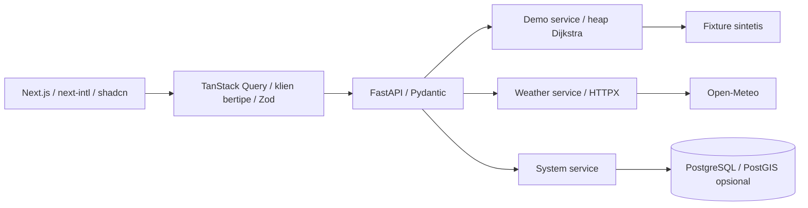

# HydroGig-Mesh

**Purwarupa penelitian mobilitas sepeda motor sadar banjir untuk pengemudi ojek online, dengan konteks awal Bogor, Indonesia.**

> **Phase 1.6 — purwarupa, bukan layanan keselamatan operasional.** Pemeriksaan rute dan EWS menggunakan graf serta skenario **sintetis**, bukan pemantauan banjir langsung. Cuaca berasal dari model penyedia eksternal dan tidak membuktikan kondisi banjir atau keselamatan suatu jalan. Belum tersedia dataset banjir tervalidasi, model DeepONet terlatih, atau ambang risiko terkalibrasi.

Repositori: [github.com/anasnasuhaaa/hydro-gig](https://github.com/anasnasuhaaa/hydro-gig). Mulai dari `/dashboard` atau baca [panduan singkat](docs/USER-GUIDE.md).

## Tentang Proyek

Pengemudi ojek online dan kurir roda dua menghadapi paparan genangan perkotaan ketika informasi tingkat ruas jalan terbatas. HydroGig-Mesh mengembangkan kerangka untuk menghubungkan informasi perjalanan, cuaca, observasi lapangan, pemodelan hidrodinamika, pencarian rute, dan dokumentasi gangguan perjalanan. Studi kasus awal berfokus pada Bogor.

**Visinya** adalah sistem pendukung keputusan yang transparan terhadap sumber data dan ketidakpastian. **Implementasi saat ini** menguji alur interaksi dan integrasi perangkat lunak melalui demonstrasi deterministik, dilengkapi konteks cuaca eksternal. Kalibrasi, evaluasi lapangan, dan pembuktian manfaat masih merupakan pekerjaan penelitian berikutnya.

## Tujuan dan Manfaat

1. Membantu pemeriksaan perjalanan sebelum pesanan diterima melalui perbandingan alternatif rute.
2. Memperlihatkan perubahan skenario dan keterbatasan informasi secara jelas.
3. Menyiapkan dokumentasi insiden yang kelak dapat diverifikasi, tanpa menjanjikan pembatalan penalti.
4. Mendukung penelitian penginderaan sukarela dan pemodelan genangan dengan persetujuan serta perlindungan privasi.

| Pihak | Manfaat yang diharapkan, belum dibuktikan di lapangan |
| --- | --- |
| Pengemudi ojol dan kurir | Konteks perjalanan dan dokumentasi gangguan yang lebih terstruktur |
| Penumpang | Transparansi dalam mempertimbangkan gangguan perjalanan |
| Peneliti | Kerangka integrasi graf, skenario, observasi, dan evaluasi model |
| Calon mitra platform | Bukti pendukung peninjauan gangguan jika kelak disepakati mekanisme penerimaannya |
| Pemerintah dan komunitas | Potensi informasi agregat untuk penelitian dan mitigasi |

## Fitur Utama

| Fitur | Perilaku dan status saat ini |
| --- | --- |
| **Pre-order Flood Screening** — `/pre-order` | Form React Hook Form/Zod memilih awal, penjemputan, tujuan, skenario, dan bingkai; API membandingkan acuan jarak dengan biaya berbobot buatan pada graf sintetis |
| **EWS Navigation** — `/navigation` | Perjalanan hasil pemeriksaan atau bawaan, bingkai manual `t0/t1/t2`, skema jaringan searah, dan peringatan simulasi; bukan navigasi geografis atau pelacakan GPS |
| **Digital Evidence & Anti-Penalty Claims** — `/claims` | Layar keterangan belum tersedia; pembuatan, penyimpanan, penandatanganan, serta verifikasi bukti masih direncanakan |
| **Konteks cuaca** — `/dashboard` | Kondisi kini berbasis model Open-Meteo, sumber/satuan/waktu, lokasi perangkat atas tindakan eksplisit, atau Bogor pilihan manual; terpisah dari simulasi banjir |
| **Bahasa dan panduan** — `/guide` | Bahasa Indonesia sebagai default, pilihan ID/EN tersimpan melalui cookie, panduan tiga langkah, tema terang/gelap, sidebar resmi shadcn dan navigasi bawah ponsel |
| **Diagnostik teknis** | Status API/basis data sebenarnya dalam bagian yang dapat dibuka; konektivitas tidak menandakan keselamatan lingkungan |

Tidak ada statistik operasional, profil pengemudi, sensor genangan, atau grafik hasil riset rekaan. Recharts dan MapLibre tersedia untuk integrasi bermakna di masa depan; peta geografis belum dipasang.

## Alur Penggunaan

**Awal → penjemputan → tujuan → periksa rute → bandingkan alternatif → buka navigasi → pilih `t0 → t1 → t2` → bukti perjalanan (rencana).**

- Gunakan tombol **ID / EN** di header untuk mengganti bahasa tanpa mengubah URL. Pilihan form dan bingkai dipertahankan saat bahasa diganti; sesi perjalanan berada di memori dan hilang saat muat ulang penuh.
- Di Dasbor, tekan **Gunakan lokasi saya** untuk meminta satu lokasi perangkat. Izin tidak diminta saat halaman dibuka. GPS memerlukan HTTPS atau localhost yang sesuai; penolakan, timeout, offline, atau perangkat tidak mendukung ditampilkan dengan jelas.
- Tekan **Pilih Bogor manual** untuk memuat cuaca tanpa GPS. Konteks selalu menandainya sebagai pilihan manual, bukan lokasi pengguna yang terdeteksi.
- Buka **Panduan** dari sidebar/navigasi bawah atau tautan **Bantuan** di pemeriksaan dan navigasi.

## Landasan Ilmiah

Rancangan penelitian mengusulkan alur **IMU/GNSS → pengolahan dan asimilasi data → hidrodinamika → prediksi operator → risiko ruas → pencarian rute → bukti digital**. Tahap-tahap ini membutuhkan bukti dan pengujian masing-masing.

| Pendekatan | Rencana dan batas implementasi |
| --- | --- |
| Penginderaan partisipatif IMU/GNSS | Telemetri sukarela dengan kalibrasi serta ketidakpastian; belum ada pengumpulan atau pelacakan pengemudi |
| Asimilasi data | Penyelarasan observasi spasial-temporal; belum diimplementasikan |
| Persamaan Air Dangkal 2D (2D SWE) | Memerlukan topografi, forcing, kondisi batas, parameter, solver, dan validasi independen; belum tersedia |
| Physics-Informed DeepONet | Calon pendekatan prediksi hidrodinamika; belum ada checkpoint, dataset pelatihan tervalidasi, atau hasil prediksi ilmiah |
| Risiko jalan / Modified Dijkstra | Integrasi modul riset direncanakan melalui protokol layanan; implementasi sementara adalah heap Dijkstra dengan panjang dan bobot sintetis buatan, **bukan risiko terkalibrasi** |
| Penandatanganan bukti | Memerlukan autentikasi, kanonisasi, pengelolaan kunci, persistensi, verifikasi, dan kesepakatan penerimaan; belum beroperasi |

Persamaan, satuan, sumber parameter, kebijakan data hilang, horizon, dan ketidakpastian dijabarkan dalam [SCIENTIFIC-MODULES.md](docs/SCIENTIFIC-MODULES.md). Tidak ada nilai ambang fisika yang direka. Data tidak diketahui tidak pernah berarti risiko rendah. Rute terjangkau atau biaya kecil tidak menjamin keselamatan.

## Arsitektur dan Teknologi



| Lapisan | Teknologi |
| --- | --- |
| Antarmuka | Next.js 16 App Router, React 19, TypeScript, Tailwind CSS 4, Geist lokal |
| UI dan aksesibilitas | shadcn/ui Radix Nova, sidebar resmi, Lucide React, Sonner, next-themes |
| State, form, bahasa | TanStack Query, klien fetch bertipe, React Hook Form, Zod, next-intl |
| Visualisasi | Skema SVG aktif; Recharts dan adapter MapLibre disiapkan, tanpa data dekoratif |
| Backend | Python 3.12+, FastAPI, Pydantic v2, pydantic-settings, HTTPX, Uvicorn |
| Persistensi | SQLAlchemy asyncio, psycopg, GeoAlchemy2, Alembic; enam model PostgreSQL/PostGIS |
| Pengujian | pytest, Ruff, TypeScript, ESLint, Prettier, Playwright Chromium desktop/ponsel emulasi |
| Target infrastruktur | Vercel frontend/backend dan Neon PostgreSQL; deployment dan koneksi Neon langsung belum diverifikasi |

Controller tetap tipis, logika berada di layanan, dan repository ditambahkan saat query persistensi nyata tersedia. Tidak ada koneksi DB saat import, migrasi startup, worker persisten, atau WebSocket berkepanjangan. Dependensi frontend dikunci dalam `pnpm-lock.yaml`; manifest Python mematok dependensi langsung. Konvensi komponen ada di `frontend/components.json`.

## Status Pengembangan

Status Phase 1.6 berdasarkan kode dan pengujian lokal, bukan kesiapan operasional:

| Komponen | Status |
| --- | --- |
| UI responsif, sidebar, navigasi bawah, tema | Tersedia dan diuji di Chromium/emulasi |
| API demo tanpa DB, graf delapan titik, Dijkstra deterministik | Tersedia; seluruhnya sintetis |
| Pemeriksaan dan EWS manual `t0/t1/t2` | Tersedia; belum prediksi kondisi sepanjang waktu tempuh |
| Bahasa Indonesia/English dan Panduan | Tersedia; SSR, cookie, dan perubahan bahasa diuji |
| Lokasi perangkat opsional dan cuaca Open-Meteo | Tersedia; provider dimock dalam tes, smoke eksternal berhasil; ketersediaan jaringan tidak dijamin |
| Model/migrasi PostGIS | Disiapkan; migrasi/koneksi DB langsung belum diverifikasi |
| Data geospasial Bogor dan observasi genangan nyata | Belum terintegrasi |
| Risiko ilmiah, SWE, DeepONet terlatih | Belum tersedia atau tervalidasi |
| Autentikasi dan RBAC | Belum tersedia |
| Klaim, token bukti, verifikasi kriptografi | Belum tersedia |
| Deployment publik, runtime Vercel Python 3.12 | Belum diverifikasi |

## Struktur Repositori

```text
frontend/
  messages/                   Katalog Indonesia dan English
  src/app/                    Layout dan lima layar utama App Router
  src/i18n/                   Konfigurasi request, cookie action, metadata
  src/components/ui/          Primitive shadcn/Radix
  src/components/layout/      Sidebar, tema, bahasa, navigasi bawah
  src/components/demo/        Form, hasil rute, sesi demo, skema EWS
  src/components/weather/     Kartu cuaca dan lokasi opsional
  src/components/dashboard/   Diagnostik API/database
  src/components/maps/        Adapter MapLibre untuk integrasi mendatang
  src/hooks/                  Query data demo dan status
  src/lib/                    Klien API, kontrak Zod, provider aplikasi
  tests/                      Pengujian browser dan kelengkapan terjemahan
backend/
  app/api/v1/endpoints/       Controller system, demo, weather
  app/services/              Status, routing, demo, cuaca, batas modul riset
  app/schemas/               Kontrak Pydantic dan respons publik
  app/core/                  Konfigurasi dan logging tersanitasi
  app/db/ dan app/models/    Koneksi lazy dan enam model domain
  demo/                     Fixture deterministik terpisah
  alembic/                  Migrasi manual
  tests/                    Tes API, kontrak, provider, model, dan logging
docs/                       Arsitektur, riset, data, panduan, validasi
AGENTS.md                   Konvensi pengembangan
```

## Menjalankan Proyek Secara Lokal

Kebutuhan: Node.js 20.9+ (Node 22 direkomendasikan), pnpm sesuai `frontend/package.json`, Python 3.12+. Jalankan perintah dari direktori aplikasi agar resolusi `.env` konsisten. Jangan menimpa konfigurasi lokal yang sudah ada saat menyalin contoh.

Backend, terminal pertama:

```bash
cd backend
python3 -m venv .venv
source .venv/bin/activate
python -m pip install -r requirements-dev.txt
cp .env.example .env
uvicorn app.main:app --reload --port 8000
```

Frontend, terminal terpisah:

```bash
cd frontend
pnpm install --frozen-lockfile
cp .env.example .env.local
pnpm dev
```

Buka [Dasbor](http://localhost:3000/dashboard), [dokumentasi API](http://localhost:8000/docs), dan [OpenAPI](http://localhost:8000/openapi.json). Demo tetap berjalan tanpa Neon; biarkan URL database kosong untuk status `not_configured`. Cuaca memerlukan internet, tetapi tidak memerlukan database atau API key untuk penggunaan nonkomersial ini. Tidak ada aplikasi yang membaca `PROMPT.md` saat runtime.

Skrip dev/build memilih Webpack yang didukung Next.js; pada lingkungan pengembangan sebelumnya worker Turbopack tidak dapat membuka port. Font disajikan lokal, sehingga build tidak memerlukan Google Fonts.

## Konfigurasi

| Lokasi | Variabel | Kegunaan |
| --- | --- | --- |
| Frontend | `NEXT_PUBLIC_API_BASE_URL` | Origin publik FastAPI, default `http://localhost:8000`; tertanam saat build |
| Frontend | `NEXT_DIST_DIR` | Direktori keluaran opsional; default `.next`, `.next-e2e` untuk pengujian terisolasi |
| Backend | `APP_ENV` | `development`, `test`, atau `production`; default `development` |
| Backend | `DATABASE_URL` | URL runtime PostgreSQL, opsional untuk demo/cuaca; gunakan TLS |
| Backend | `DIRECT_DATABASE_URL` | URL langsung untuk migrasi Alembic |
| Backend | `CORS_ORIGINS` | Origin frontend eksplisit dipisah koma, default `http://localhost:3000` |
| Backend | `LOG_LEVEL` | Default `INFO`; hindari debug HTTP yang merekam lokasi |

Gunakan `.env.example` tanpa kredensial; `.env` diabaikan Git. Kredensial hanya di server, tidak di `NEXT_PUBLIC_*`, log, atau status. Origin CORS tidak memakai wildcard, path, atau garis miring penutup. Daftar kosong berarti tidak ada akses lintas origin.

### API

| Endpoint | Perilaku |
| --- | --- |
| `GET /`, `GET /health` | Identitas API dan liveness tanpa DB |
| `GET /api/v1/system/status` | Status database, waktu pemeriksaan, dan ketiadaan data banjir; field fase kontrak tetap `foundation` |
| `GET /api/v1/demo/manifest`, `/scenarios`, `/network` | Metadata, skenario dan graf sintetis |
| `GET /api/v1/demo/scenarios/{scenario_id}/frames/{step}` | Snapshot fiktif, biaya buatan, nilai fisika/risiko tidak tersedia |
| `POST /api/v1/demo/screen` | Dua bagian perjalanan, alternatif acuan jarak dan berbobot demo |
| `GET /api/v1/weather/current?latitude=...&longitude=...` | Kondisi berbasis model, sumber, satuan, waktu model/pengambilan; kegagalan provider HTTP 503, input invalid HTTP 422 |
| `GET /docs`, `/openapi.json` | Dokumentasi dan skema API |

Status sistem tetap HTTP 200 untuk database terdegradasi, dengan state `not_configured`, `reachable`, atau `unreachable`. Pemeriksaan DB dibatasi deadline empat detik, koneksi tiga detik, dan statement dua detik. Status tidak membocorkan URL, kredensial, hostname infrastruktur, atau stack trace. Kontrak demo dan provenance lama tidak diubah.

### Basis data dan migrasi opsional

Siapkan Neon/PostgreSQL secara manual, aktifkan PostGIS, dan isi URL TLS runtime/direct jika membutuhkan verifikasi persistensi. Tidak ada Neon yang dianggap sudah terkonfigurasi. Tinjau migrasi sebelum menjalankan:

```bash
cd backend
source .venv/bin/activate
alembic upgrade head
alembic current
```

Enam tabel awal: `drivers`, `road_segments`, `flood_scenarios`, `flood_observations`, `trips`, `claims`, dengan UUID, foreign key, timestamp berzona, provenance, geometri SRID 4326, dan indeks GiST. Tidak ada observasi atau konstanta model yang di-seed. Lihat [DATABASE.md](docs/DATABASE.md), termasuk persiapan ekstensi dan verifikasi pada basis data pengembangan yang boleh dibuang.

## Pengujian

Dari `backend/` dengan virtual environment aktif:

```bash
python -m pytest -q
ruff check .
ruff format --check .
```

Dari `frontend/`:

```bash
pnpm typecheck
pnpm lint
pnpm format:check
pnpm build
pnpm exec playwright install chromium
pnpm build:e2e
pnpm test:e2e
```

`build:e2e` membuat build produksi `.next-e2e` dengan API port 8100. Playwright menjalankan frontend 3100/backend 8100 tanpa DB dan tidak memakai server yang sudah aktif. Kedua port harus tersedia; dev 3000/8000 dapat tetap berjalan. Bila dev aktif, jalankan pemeriksaan `pnpm build` dengan `NEXT_DIST_DIR=.next-e2e NEXT_PUBLIC_API_BASE_URL=http://localhost:8100` agar tidak menulis `.next` bersamaan. Sistem Linux mungkin memerlukan pustaka Chromium tambahan.

Tes mencakup API demo nyata lokal, kegagalan/malformed response, consent GPS, provider cuaca dimock tanpa internet, i18n/SSR/cookie, Guide, sidebar/fokus/shortcut, tema, dan layout 320/375/1280 px. Hasil aktual dan batas lingkungan dicatat di [VALIDATION.md](docs/VALIDATION.md). Pengujian Chromium bukan pengujian perangkat fisik atau Safari/Firefox.

## Deployment

**Deployment masih target, belum diverifikasi.** Jangan menganggap konfigurasi sebagai bukti bahwa layanan sudah dipublikasikan. Persiapan yang direncanakan:

1. Proyek Vercel frontend berakar di `frontend`, framework Next.js, install frozen lockfile dan `pnpm build`. Tentukan URL backend HTTPS sebelum build.
2. Proyek backend berakar di `backend`, FastAPI/Python. `app/main.py` mengekspor `app`, `pyproject.toml` menunjuk `app.main:app`, manifest runtime memuat HTTPX, dan `.python-version` meminta Python 3.12. Tidak dibutuhkan rewrite Vercel lama. Rujukan persiapan: [konvensi FastAPI Vercel](https://vercel.com/docs/frameworks/backend/fastapi).
3. Jika persistensi diperlukan, siapkan cabang Neon terpisah, PostGIS dan migrasi manual. Atur URL backend, `APP_ENV=production`, log INFO, dan origin frontend CORS yang tepat.
4. Pisahkan konfigurasi preview/produksi, periksa health/docs/status, batas trafik provider, redaksi log query lokasi di hosting, serta alur cuaca/demo setelah deployment yang diotorisasi. Jangan menonaktifkan proteksi platform secara global untuk mengatasi salah konfigurasi.

Koneksi runtime memakai NullPool. DB yang dapat dihubungi tidak membuktikan kesiapan schema atau PostGIS. Tidak ada push atau deployment dilakukan pada tahap implementasi ini.

## Sumber Data dan Atribusi

- **Demo:** `backend/demo/fixtures.json` adalah graf delapan titik dengan sembilan ruas dan tiga bingkai buatan; nilai kedalaman, kecepatan air, dan risiko ilmiah tetap tidak tersedia. Waktu skenario bersifat fiktif.
- **Cuaca:** [Open-Meteo](https://open-meteo.com/) menyediakan kondisi kini berbasis model, dengan atribusi [CC BY 4.0](https://creativecommons.org/licenses/by/4.0/). `model_time` berasal dari provider, `fetched_at` dari server; UI menampilkan Asia/Jakarta. Presipitasi merupakan total pada interval sebelumnya, bukan kedalaman banjir.
- **Batas layanan:** menurut [syarat Open-Meteo](https://open-meteo.com/en/terms) yang diperiksa 4 November 2026, API gratis untuk nonkomersial dibatasi kurang dari 10.000 panggilan/hari, 5.000/jam dan 600/menit. Shared IP dapat dibatasi lebih cepat. Aplikasi komersial/operasional perlu peninjauan paket dan lisensi; tujuan penelitian tidak otomatis membolehkan semua bentuk pemakaian.
- **Kesegaran:** Query cuaca menggunakan interval/cache sepuluh menit dan tombol pembaruan dibatasi. Respons lama diberi penanda; data kosong tidak diganti nol. Tidak ada cache server bersama atau pembatas kuota global. Detail waktu, kegagalan, privasi dan provider ada di [WEATHER.md](docs/WEATHER.md).
- **Peta mendatang:** belum ada data geografis OSM yang terintegrasi. Integrasi OSM atau sumber lain wajib mempertahankan sumber, versi, CRS/satuan, lisensi, atribusi yang sesuai, dan ketentuan penyedia tile. Jangan menambahkan peta beratribusi palsu atau geometri sintetis seolah jalan Bogor nyata.

## Roadmap

1. **Selesai sebagai fondasi:** aplikasi responsif, API, kontrak data, model DB/migrasi manual, dan tes.
2. **Selesai sebagai demonstrasi:** graf sintetis, Dijkstra, pemeriksaan dan EWS manual; bukan hasil validasi ilmiah.
3. **Tersedia pada Phase 1.6:** UI biru mobile-first, ID/EN, Panduan, lokasi opsional dan cuaca model eksternal.
4. **Integrasi riset berikutnya:** jaringan jalan berlisensi, modul risiko/Modified Dijkstra, skenario dan dataset pembanding yang disepakati, satuan serta ketidakpastian tervalidasi.
5. **Bukti digital berikutnya:** autentikasi/RBAC, persetujuan, penyimpanan, kanonisasi, penandatanganan/verifikasi, pengelolaan kunci dan penerimaan pihak platform.
6. **Validasi ilmiah berikutnya:** penginderaan sukarela, kalibrasi, asimilasi, SWE, DeepONet dan evaluasi lapangan independen.

Lihat [ROADMAP.md](docs/ROADMAP.md). Belum ada jaminan jadwal atau hasil manfaat operasional.

## Dokumentasi

- [Panduan penggunaan](docs/USER-GUIDE.md) dan [integrasi cuaca](docs/WEATHER.md).
- [Lokalisasi](docs/LOCALIZATION.md) dan [arsitektur](docs/ARCHITECTURE.md).
- [Kontrak data](docs/DATA-CONTRACTS.md), [demo sintetis](docs/DEMO-SIMULATION.md), dan [batas modul ilmiah](docs/SCIENTIFIC-MODULES.md).
- [Database](docs/DATABASE.md), [roadmap](docs/ROADMAP.md), dan [hasil validasi](docs/VALIDATION.md).
- [Implementasi Phase 1.5](docs/PHASE-1.5-IMPLEMENTATION.md), [penyempurnaan UI sebelumnya](docs/UI-REFINEMENT.md), dan [catatan Phase 1.6](docs/PHASE-1.6-IMPLEMENTATION.md).

## Keamanan, Privasi dan Batasan

- Jangan memasuki genangan untuk menguji aplikasi. Kondisi tidak diketahui tidak berarti aman; cuaca cerah juga tidak membuktikan jalan bebas banjir.
- Lokasi diminta satu kali atas tindakan pengguna, dibulatkan dua desimal, dan dikirim untuk konteks cuaca. Tidak ada riwayat GPS, akun, telemetri, penyimpanan koordinat jangka panjang, atau analytics baru.
- Query koordinat direduksi dari log akses Uvicorn; log URL HTTPX dibatasi. Redaksi pada reverse proxy/hosting masih harus diverifikasi sebelum publikasi. Tidak ada klaim anonimitas terhadap penyedia cuaca.
- Kredensial hanya di server. Auth/RBAC belum ada, sehingga jangan menambahkan data insiden atau identitas sensitif sebelum kontrol akses tersedia.
- Klaim internal mendatang tidak otomatis diterima platform dan tidak otomatis membatalkan penalti.
- Belum ada verifikasi Neon/PostGIS langsung, model ilmiah, peta nyata, atau deployment. Semua keterbatasan harus tetap terlihat pada pengembangan berikutnya.

## Kontribusi dan Lisensi

Ikuti [AGENTS.md](AGENTS.md), baca panduan Next.js lokal sebelum mengubah framework, pertahankan primitive shadcn/Radix, dan jalankan quality gate yang relevan. Tambahkan terjemahan pada kedua katalog dan jangan mengubah provenance/ID API untuk kebutuhan tampilan. Penambahan primitive dapat menggunakan `pnpm dlx shadcn@latest add <component>` dari direktori frontend. Input lokal `PROMPT.md` tidak boleh di-stage; push/deployment memerlukan instruksi eksplisit.

Belum ada berkas `LICENSE` pada repositori ini; jangan mengasumsikan lisensi kode dari status publik repositori. Lisensi dependensi dan sumber data tetap berlaku masing-masing, termasuk atribusi cuaca. Ketentuan kontribusi dan penggunaan kode perlu disepakati dengan pengelola.
