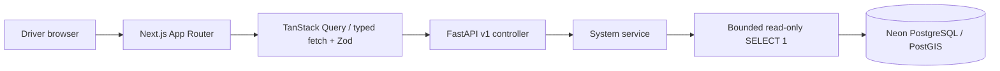

# Architecture

HydroGig-Mesh is a Phase 1 research foundation for motorcycle ride-hailing drivers in Bogor. The frontend and backend are independently deployable applications in one repository. No authentication is enabled in this phase; no sensitive records are exposed through the public API.

## Responsibilities and request flow

Next.js serves page structure, semantic design tokens, navigation, and empty states. Small client boundaries own theme, drawer, query cache, and connectivity controls. The root redirects to `/dashboard`; `/pre-order`, `/navigation`, and `/claims` are accessible feature shells. No scientific API or operational safety decision is implemented.

`frontend/src/lib/api/client.ts` validates responses with Zod, checks HTTP status, supports cancellation, and bounds requests to eight seconds. TanStack Query uses a 30-second stale interval, one retry, and one-minute refresh. Failed refreshes do not present cached status as current. Status is fetched in the browser; the frontend needs no backend at build time.

FastAPI controllers call services and return Pydantic schemas. Settings mask database URLs. Health tests application liveness independently of database readiness. Status uses asynchronous psycopg, a four-second deadline, three-second connection timeout, and two-second statement timeout. Failures return safe status values and fixed structured log events. Connections are lazy, use NullPool, and are disposed after checks. No startup migrations or background workers are present.

Models and Alembic define persistence separately from controllers. Introduce repositories when real entity queries are implemented; empty repository/scientific stubs are deliberately omitted. Future service ownership and inputs/outputs are specified in [SCIENTIFIC-MODULES.md](SCIENTIFIC-MODULES.md).

## UI conventions

shadcn/ui is initialized in `frontend/components.json` with the Radix Nova preset, CSS variables, `@/` aliases, and Lucide. Generated Button, Card, Badge, Sheet, Tooltip, Separator, Skeleton, Alert, and Sonner components are shared primitives. Desktop navigation collapses; mobile navigation uses a Radix Sheet with focus management and close-on-navigation. A skip link, semantic navigation, accessible status messages, and focus treatments support keyboard use.

Geist is self-hosted from Fontsource, so builds do not fetch Google Fonts. Teal, ocean blue, cyan-tinted surfaces, and slate neutrals use semantic tokens. `next-themes` handles system/light/dark. Risk colors are UI vocabulary without numerical classifications. Sonner is the only toast provider. Recharts is installed for future meaningful charts; no decorative monitoring data is fabricated. React Hook Form and its Zod resolver are installed for future validated forms; no unusable input form is shown now.

`components/maps/map-canvas.tsx` is a client-only MapLibre adapter. It imports the browser library after mount, requires a caller-supplied style, provides map navigation/attribution, handles load failures, and disposes resources. It is not mounted because no tile provider, route, or flood layer is configured. No tile service or API key is assumed.

## Deployment and trust boundaries

Use two Vercel projects rooted at `frontend` and `backend`, and a manually configured Neon database. FastAPI exports `app` from `app/main.py` with `tool.vercel.entrypoint`; no legacy rewrites are needed. See [Vercel FastAPI documentation](https://vercel.com/docs/frameworks/backend/fastapi). Each environment needs its own database branch, API URL, and CORS origins. The frontend API URL is public and baked into its build; database credentials stay in backend/migration environments.

Public status exposes only configured/reachable flags, application state, phase, timestamp, and data availability. This is infrastructure status, not environmental monitoring. Before sensitive data or mutations are added, implement authorization, abuse controls, audit policy, and privacy requirements. Server health does not imply flood safety.
