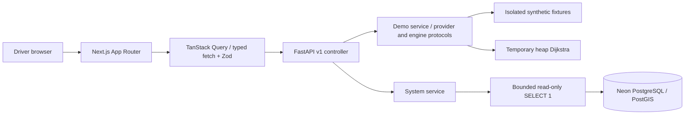

# Architecture

HydroGig-Mesh is a Phase 1.5 experimental research workspace for motorcycle ride-hailing drivers in Bogor. The frontend and backend are independently deployable applications in one repository. No authentication is enabled in this phase; no sensitive records are exposed through the public API.

## Responsibilities and request flow

Next.js serves page structure, semantic design tokens, navigation and honest availability states. Client boundaries own theme, sidebar, query cache, demo forms and schematic visualization. The root redirects to `/dashboard`; `/pre-order` performs synthetic screening and `/navigation` explores explicit frames. `/claims` remains unavailable. No scientific API or operational safety decision is implemented.

`frontend/src/lib/api/client.ts` validates responses with Zod, checks HTTP status, supports cancellation, and bounds requests to eight seconds. TanStack Query uses a 30-second stale interval, one retry, and one-minute refresh. Failed refreshes do not present cached status as current. Status is fetched in the browser; the frontend needs no backend at build time.

FastAPI controllers call services and return Pydantic schemas. Settings mask database URLs. Health tests application liveness independently of database readiness. Status uses asynchronous psycopg, a four-second deadline, three-second connection timeout, and two-second statement timeout. Failures return safe status values and fixed structured log events. Connections are lazy, use NullPool, and are disposed after checks. No startup migrations or background workers are present.

Models and Alembic define persistence separately from controllers. Introduce repositories when real entity queries are implemented; empty repository/scientific stubs are deliberately omitted. Future service ownership and inputs/outputs are specified in [SCIENTIFIC-MODULES.md](SCIENTIFIC-MODULES.md).

## UI conventions

shadcn/ui is initialized in `frontend/components.json` with the Radix Nova preset, CSS variables, `@/` aliases, and Lucide. Generated Sidebar, Select, Input, Button, Card, Badge, Sheet, Tooltip, Separator, Skeleton, Alert and Sonner components are shared primitives. One SidebarProvider owns desktop/mobile state. Desktop uses `collapsible="icon"` with an accessible header trigger, tooltips, active links and automatic content sizing through SidebarInset. The same Sidebar uses its official mobile Radix Sheet with focus handling and close-on-navigation. The generated mobile hook uses useSyncExternalStore for hydration-safe media-query subscription. A skip link, semantic navigation, accessible status messages, and focus treatments support keyboard use.

Geist is self-hosted from Fontsource, so builds do not fetch Google Fonts. Teal, ocean blue, cyan-tinted surfaces, and slate neutrals use semantic tokens. `next-themes` handles system/light/dark. Risk colors are UI vocabulary without numerical classifications. Sonner is the only toast provider. Recharts is installed for future meaningful charts; no decorative monitoring data is fabricated. React Hook Form and its Zod resolver validate the demo screening form. A dashboard-layout DemoSessionProvider retains the selected trip/frame across client navigation; full reload resets it. TanStack mutations only announce success after the API responds. EWS queries include the entire trip/frame key and hide stale routes while fetching or on errors.

`components/maps/map-canvas.tsx` is a client-only MapLibre adapter. It imports the browser library after mount, requires a caller-supplied style, provides map navigation/attribution, handles load failures, and disposes resources. It is not mounted because no tile provider, route, or flood layer is configured. No tile service or API key is assumed.

## Deployment and trust boundaries

Use two Vercel projects rooted at `frontend` and `backend`, and a manually configured Neon database. FastAPI exports `app` from `app/main.py` with `tool.vercel.entrypoint`; no legacy rewrites are needed. See [Vercel FastAPI documentation](https://vercel.com/docs/frameworks/backend/fastapi). Each environment needs its own database branch, API URL, and CORS origins. The frontend API URL is public and baked into its build; database credentials stay in backend/migration environments.

Public status exposes only configured/reachable flags, application state, phase, timestamp, and data availability. This is infrastructure status, not environmental monitoring. Before sensitive data or mutations are added, implement authorization, abuse controls, audit policy, and privacy requirements. Server health does not imply flood safety.

## Dataset-independent demo and replacement boundaries

Pydantic v2 normalized network/scenario/observation/risk/route models and matching Zod schemas live separately from SQLAlchemy. All `/api/v1/demo` endpoints return explicit simulation/experimental envelopes. `backend/demo/fixtures.json` contains a reproducible eight-node, nine-edge schematic plus three fixed frames and its manifest. Physical values and scientific risk are unavailable, never generated. The demo provider reads fresh validated data per call; there is no mutable global frame, DB initialization, seeding, background polling loop or WebSocket. Fixtures are packaged with the backend for serverless file reads.

Thin controllers inject DemoService, which delegates to ScenarioProvider, WeightingProvider and RoutingEngine protocols. FixtureWeighting supplies complete authored nonnegative costs; DijkstraEngine reconstructs directed routes and supports zero costs, parallel/two-way segments and unreachable legs. A future NetworkAdapter must explicitly map GraphML/GeoJSON source fields, CRS, units and IDs into RoadNetwork. The research module can replace weighting and/or routing through the service factory without coupling HTTP to its implementation. Demo endpoint provenance must remain synthetic; real observations/predictions require distinct provider/API presentation.

The isolated SchematicNetwork adapter draws only LOCAL:SCHEMATIC positions. It can be replaced by a GeoJSON/MapLibre visualization when source CRS, geometry and licensed style are available. Frame changes are user-driven snapshots rather than route-traversal forecasts. No Recharts plot is added because the current information is clearer as segment comparisons.

GET/POST CORS is limited to configured frontend origins. Screening is a pure read/calculation POST and persists nothing. Existing system health/readiness behavior, SQLAlchemy models and Alembic history are preserved. Claim request/unavailable-response models and server-only ClaimIssuer/EvidenceSigner protocols prepare integration without token generation or keys. See [DATA-CONTRACTS.md](DATA-CONTRACTS.md) and [DEMO-SIMULATION.md](DEMO-SIMULATION.md) for formal semantics, examples and limitations.
