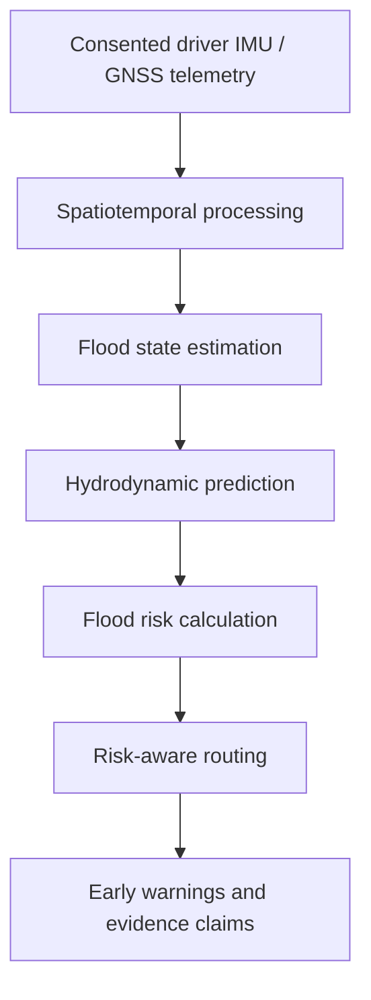

# Future scientific integration contracts

No validated hydrological dataset, trained DeepONet checkpoint, calibrated risk engine, or operational flood prediction service is available. These are proposed boundaries, not implemented algorithms. Add modules under `backend/app/services/` when real implementations have evidence and tests; avoid placeholder methods returning plausible values.

Every boundary must retain source IDs, spatial CRS, physical units, observation/valid/issue times, provenance (`observed`, `simulated`, `model_predicted`), model/parameter versions, quality flags, uncertainty, and validity area/horizon. Unknown or stale values are explicit unavailable states, never zero risk. Observed data may contain errors; provenance alone is not validation. Simulated and model-predicted outputs must remain visibly distinct from observations in APIs and UI.

| Future service | Required inputs and parameters | Expected outputs | Data and validation dependencies |
| --- | --- | --- | --- |
| `telemetry` | Consented GNSS fixes, timestamps, IMU axes, device calibration, road matching, position/clock uncertainty | Quality-controlled, time-aligned samples and derived speed features | Sensor calibration, sampling/latency characterization, privacy and retention policy; driving behavior has many non-flood causes |
| `flood` state estimation | Georeferenced observations, elevation, drainage/terrain context, rainfall, spatial/temporal error models | Time-indexed depth/velocity field with uncertainty and provenance | Ground truth gauges/surveys and assimilation validation; sparse telemetry does not directly measure flood depth |
| `flood` hydrodynamics | Terrain/bathymetry, mesh, initial/boundary conditions, rainfall, roughness, source/friction terms | Depth h and velocities u,v over space/time, conserved quantities and quality flags | Validated solver, boundary/forcing data, wet/dry handling, convergence, independent flood events |
| `flood` operator provider | Boundary/forcing functions, query coordinates/time, trained checkpoint and training manifest | Model-predicted fields with domain/horizon limits and uncertainty | Actual checkpoint; separate training/validation/test events; conservation, residual, stability and out-of-distribution evaluation |
| `risk` | h,u,v, vehicle geometry/stability parameters, critical depth/momentum parameters, uncertainty | Versioned experimental risk values, unavailable reasons, confidence context | Motorcycle-specific empirical studies and sensitivity analysis; no arbitrary critical thresholds |
| `routing` | Road graph, edge lengths/access restrictions, temporal risk, risk preference parameters | Candidate routes, costs, exclusions, data gaps and explanation | Licensed/traceable road data, graph connectivity, time semantics, overflow guards; route availability is not a safety guarantee |
| `claims` | Trip, time/location, source observations, canonical evidence envelope, authorization and signing keys | Verifiable signed evidence plus digest and verification outcome | Chain-of-custody, key rotation/revocation, replay protection, consent and platform agreement; no guaranteed penalty reversal |

## Intended research expressions

The following equations describe research intent. No values are assigned to physical parameters or thresholds in Phase 1.

- Vehicle speed ratio: `Rv = v_actual / v_free`. Both velocities must use consistent units; free-flow reference speed needs a defensible road/time reference and must be nonzero. Congestion, stops, and behavior confound flood inference.
- Hydrodynamic drag: `Fd = 0.5 * rho_water * Cd * A * v_relative^2`. Required parameters include water density, experimentally supported drag coefficient, effective submerged area, and relative flow speed. Units must yield force; applicability depends on vehicle/flow conditions.
- Two-dimensional shallow water equations: `dU/dt + dF(U)/dx + dG(U)/dy = Sb + Sf + Sr`. Define state/flux conventions, bed slope, friction and rainfall terms, forcing units, boundary conditions, spatial discretization, stability, and wet/dry treatment before implementation.
- Physics-Informed DeepONet: `G_theta(u_bc)(xi) = sum(b_p(u_bc) * tau_p(xi)) + b0`. Define boundary-function encoding, spatial/time coordinates, branch/trunk dimensions, training losses, normalization, checkpoint provenance, and physical constraints. There is no trained operator in this repository.
- Risk index: `Phi = max(h / z_crit, h * sqrt(u² + v²) / M_crit)`. Critical parameters must be positive, empirically justified and dimensionally compatible; their values and uncertainty are unknown. No low/moderate/high thresholds are scientifically assigned.
- Risk-weighted edge cost: `W(edge,t) = L(edge) * (1 + beta * exp(gamma * Phi))`. Define nonnegative preference parameters, numerical overflow handling, time-dependent graph semantics, missing-risk policy and impassability separately. Increasing cost alone cannot establish route safety.

Each future provider must have a reproducible dataset manifest, uncertainty evaluation, tests against trusted reference cases, and explicit limitations before integration. Never substitute fabricated observations or random model outputs for unavailable science.
